# 😴 NoSleep

**Stop jiggling your mouse. Stop holding spacebar in Notepad. Stop playing videos on loop.**

NoSleep keeps your Windows session — and your Teams status — **Available** with one tiny PowerShell script and a live dashboard. No installs, no admin rights, no weird tricks.




## The tricks everyone uses (and why they suck)

| Trick | The problem |
|---|---|
| Mouse jiggler app / auto mouse mover | Extra software, IT flags it, looks dodgy |
| Notepad + holding the spacebar | Fills your document with spaces and blocks your keyboard |
| Video on loop | Wastes bandwidth, obvious on a screen share |
| Taping a key down | Really? |
| **NoSleep** | One script, an honest heartbeat, a dashboard that shows it working ✅ |

## What it does

- Sends a **Scroll Lock heartbeat** every 60 seconds, so Windows never thinks you're idle
- Your **Teams status stays Available (green)** instead of flipping to Away
- Live **Insomnia System Dashboard** in the terminal: status, uptime, cycle count, progress bars
- Stops cleanly with `Ctrl+C` — nothing keeps running after you close it

## Why Scroll Lock?

Scroll Lock does nothing in almost every app, so toggling it is invisible. It registers as activity with Windows without typing anything, moving anything, or touching any window. That's the whole trick — there is no trick.

## Quick start

```powershell
git clone https://github.com/ProNoob-Dev/nosleep.git
cd nosleep
.\nosleep.ps1
```

Or just download `nosleep.ps1` and run it. To change the heartbeat interval:

```powershell
.\nosleep.ps1 -sleep 30
```

Press `Ctrl+C` to stop.

## How it works

Each cycle:

1. **Heartbeat** — toggles Scroll Lock twice (on, off) via `WScript.Shell`. Windows sees activity; nothing on screen changes.
2. **Countdown** — a live progress bar counts down the cycle.
3. **Dashboard** — uptime, cycles, session progress and uptime indicators refresh.
4. **Repeat** — until you stop the script.

## Parameters

| Parameter | Default | Description |
|---|---|---|
| `-sleep` | `60` | Cycle length in seconds (the countdown bar steps at `sleep * 10` ms per percent) |

## Requirements

- Windows
- PowerShell 5.1+ (Windows PowerShell or PowerShell 7+)

## Notes

- Keep the PowerShell window open while you want to stay awake.
- Scroll Lock may briefly flash on keyboards that have an LED for it.
- Local only — nothing leaves your machine, no admin rights needed for normal use.

## License

MIT — see [LICENSE](LICENSE).
